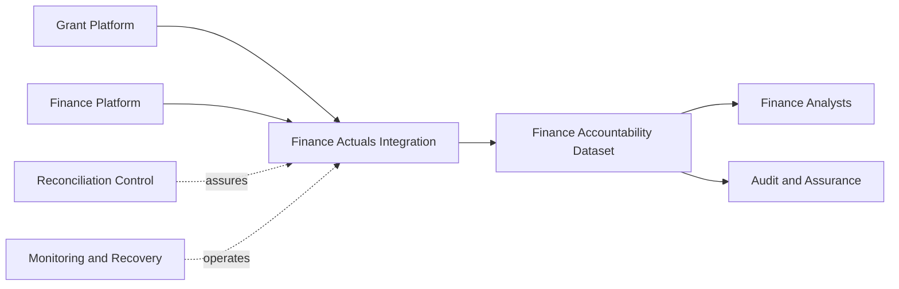

# Example Research Council — Funding Data Service High-Level Architecture

## Purpose and Scope

Connect the financial-accountability outcome to the consumers, sources, capabilities, product, delivery path, controls, operations, technology, and decision that support it.

## Solution Summary

The Funding Data Service provides Finance analysts and assurance stakeholders with a monthly, reconciled view of payment actuals linked to approved grant commitments. It combines records from the Grant Platform and Finance Platform into a governed Finance Accountability Dataset.

A scheduled integration flow standardises and matches the records. Reconciliation controls prevent incomplete results from replacing the last successful product, while monitoring and recovery capabilities support reliable operation.

The example uses managed relational storage. The implementation choice is confirmed retrospectively, but the original alternatives and selection criteria remain open for validation.

## High-Level Architecture View

## Business Outcomes

[UC-001](business-use-cases/UC-001-financial-accountability.md) establishes financial accountability by reconciling actual payments to approved commitments.

## Consumers

Finance Analysts perform monthly reconciliation and investigation. Audit and Assurance stakeholders require stable coverage and traceability evidence.

## Source Boundary

[SRC-001](sources.md#src-001--grant-platform) originates commitments. [SRC-002](sources.md#src-002--finance-platform) originates payment actuals. Internal staging and storage are not sources.

## Required Capabilities

[RC-001](required-capabilities/RC-001-reconciled-financial-representation.md) requires acquisition, matching, exception management, monthly availability, traceability, and last-good-state protection.

## Data Products

[DP-001](data-products/DP-001-finance-accountability-dataset.md) is the managed information product consumed by Finance and assurance stakeholders.

## Principal Data Flows

[DF-001](data-flows/DF-001-finance-actuals-integration.md) acquires the two source domains, standardises identifiers, performs matching, validates the result, and updates DP-001.

## Quality and Trust

[QC-001](quality-controls/QC-001-payment-and-commitment-reconciliation.md) checks duplicate, unmatched, missing, and coverage conditions before publication.

## Operations and Monitoring

[OC-001](operational-capabilities/OC-001-scheduled-build-monitoring-and-recovery.md) schedules, observes, retries, stops, and recovers the build while preserving the last successful product.

## Technologies

TECH-001 provides managed relational storage. TECH-002 provides scheduled data integration.

## Architecture-Shaping Decisions

[ADR-001](architecture-decision-records/ADR-001-use-managed-relational-storage.md) records the retrospective storage-platform choice and its open rationale questions.

## Current, Transitional, and Target State

The synthetic example represents a current-state baseline. No transition or target replacement is asserted.

## Cross-Cutting Risks and Open Questions

- Accountable product ownership is not confirmed.
- Coverage acceptance, month-end cut-off, and recovery targets remain open.
- The original storage-platform comparison is not available.
