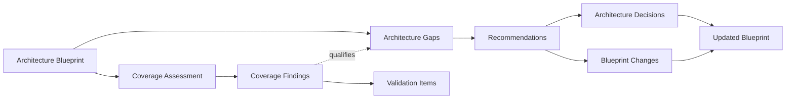

# Architecture Blueprint Review Knowledge Model

## 1. Purpose

The model joins three distinct bodies of review knowledge:

1. **Coverage** - whether the Blueprint is sufficiently complete, coherent and connected for architecture conclusions to be trusted.
2. **Gaps** - material differences between an expected architecture condition and the current condition.
3. **Recommendations** - target architecture improvements, implementation paths, acceptance measures and required decision/Blueprint changes.

Coverage findings, gaps and recommendations are related but not interchangeable.

## 2. Shared metadata

`status` describes architecture lifecycle: `current`, `planned`, `target`, `transitional`, `deprecated`, `retired`.

`confidence` describes reliability: `high`, `medium`, `low`, `not_assessed`.

`validation` describes reviewer response: `confirmed`, `needs_correction`, `incomplete`, `unable_to_validate`, `not_applicable`.

Gap and recommendation lifecycle is stored separately in `state`.

## 3. Core concepts

### Architecture Blueprint Review

A versioned assessment of exactly one declared Blueprint snapshot.

### Coverage Finding

A limitation, inconsistency or missing relationship that changes review confidence. It is not automatically an architecture defect.

### Validation Item

A material information need that must be resolved before an architecture deficiency can be asserted. Validation Items are not included in gap counts.

### Architecture Gap

A durable, solution-independent statement of the difference between an expected architecture condition and the current condition, together with material impact.

### Architecture Recommendation

A proposed target architecture improvement intended to address one or more gaps. A recommendation is not an ADR; accepted direction should be governed through the relevant decision record(s).

### Aggregated Architecture Conclusion

An executive synthesis of several detailed gaps/recommendations. It is not a new `GAP-NNN` record.

## 4. Relationships

Rules:

- one Review reviews exactly one declared Blueprint snapshot;
- one gap file per stable `GAP-NNN`;
- one validation file per stable `VAL-NNN`;
- recommendations reference one or more originating gaps;
- gap and recommendation affected-elements references must resolve to Blueprint IDs when an ID-based Blueprint is used;
- downstream Word/slides render the Review and do not own review knowledge.

## 5. Gap lifecycle

`candidate -> active -> planned -> in_progress -> mitigated/closed`

Terminal/history states: `absorbed`, `superseded`, `rejected`.

Use `candidate` when evidence supports a likely material mismatch but customer/design validation is pending. Use `active` only after confirmation. Use `closed` only after acceptance measures and the expected condition are validated.

## 6. Recommendation lifecycle

`proposed -> accepted -> planned -> in_progress -> implemented -> validated -> completed`

Alternative states: `rejected`, `deferred`, `superseded`.

## 7. Integrity constraints

- Unknown is not a gap.
- Gap statements are solution-independent.
- Recommendation acceptance does not close the gap by itself.
- Every recommendation has observable acceptance measures.
- Every gap remains traceable to Blueprint evidence/elements.
- Counts in integrated review/registers/downstream assets must be derived from the authoritative artifact set, not manually maintained independently.

## 7. Coverage rubric provenance

Coverage uses ten architecture-agnostic dimensions. The skill default rubric lives in `config/defaults.yaml`; a user-supplied portable override may enable/disable dimensions and change their weights without modifying the skill defaults.

Each coverage category preserves its raw dimension scores in `coverage_dimensions`. `null` means N/A for that category. The calculated category total is derived from the enabled and applicable dimensions only, with their weights renormalized. The combined score is the arithmetic mean of in-scope category totals.

`coverage_model_hash` identifies the exact enabled/weight model used. The resolved portable rubric is copied into `review-model/coverage-rubric.yaml` so the Review OKF remains reproducible.
